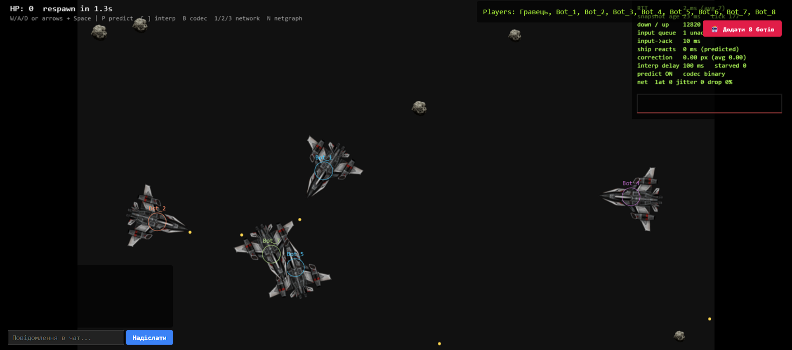
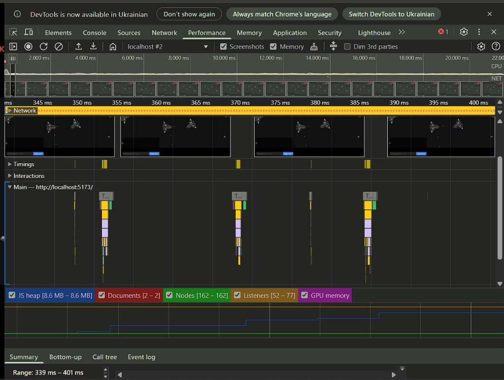
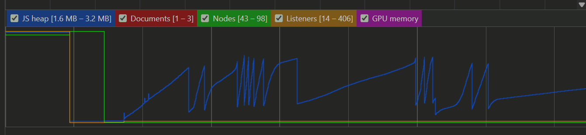

# Lab 7: V8, пам'ять і тести (Engines, Memory, and Tests)

---

## 1. Тестовий комплекс 

У проєкті розгорнуто повний набір швидких модульних (unit), детерміністичних, фейк-таймерних та генеративних (property-based) тестів на базі **Vitest** та **fast-check**:

- **Загальна кількість тестів:** 76 тестів у 10 тестових сюїтах (вимога $\ge 60$).
- **Покриття `shared/`:** **94.7% рядків (Lines), 93.78% виразів (Stmts), 92.39% функцій, 86.38% гілок** (вимога $\ge 85\%$).
- **5 Property-Based тестів (`fast-check`):**
  1. *Codec Round-Trip:* зворотне декодування вхідного повідомлення дає ідентичні значення прапорців та квантованого кута.
  2. *Spec Length Invariant:* довжина бінарного знімка `encodeSnapshot` строго дорівнює специфікації формату (`15 + nShips*25 + nBullets*20 + nAsteroids*13` байт).
  3. *Garbage Buffer Safety:* довільні зіпсовані/випадкові байти ніколи не призводять до падіння процесу (fatal crash), а повертають типізовану помилку `{ ok: false }` або контрольований `Error`.
  4. *Arena Invariant:* корабель під впливом 1000 випадкових кроків вводу завжди залишається в межах арени $[0, 1280) \times [0, 720)$.
  5. *Parser Acceptance/Rejection:* парсер `parseClientMessage` приймає будь-яке валідне згенероване повідомлення і відхиляє будь-яку спотворену мутацію.
- **Unit-тести:**
  - `Vector2`: додавання, віднімання, скалярне множення, скалярний добуток, довжина, нормалізація та scratch-вектори.
  - `integrate`: відокремленість від мутацій аргументу, прискорення за кутом, поворот, аеродинамічний опір (drag) та тор-обгортання меж.
  - `Колізії`: перекриття (overlap), дотик на межі радіусів (touching), промах (missing) та тунелювання дискретної перевірки для надшвидких куль.
  - `Детермінізм кроку World.step`: глибоке клонування світу та покрокове виконання дають однаковий хеш стану `hashWorld`.
  - `Чиста функція звірки (reconciliation)`: точний розрахунок дельти поправки, відсікання підтверджених інпутів та миттєвий snap при розбіжності > 120 px.
  - `TokenBucket Rate Limiter`: перевірка ємності сплеску, лінійного поповнення з часом та блокування при перевищенні ліміту.
  - `Ігровий цикл (Accumulator Loop)`: використання фейкових таймерів `vi.useFakeTimers()` для перевірки фіксованого кроку симуляції та захисту від спіралі смерті (clamp 250 мс).

---

## 2. End-to-End тестування та CI 

### Playwright E2E сценарій (`e2e/multiplayer.spec.ts`)
Playwright запускає Chromium з двома ізольованими браузерними контекстами в одній кімнаті:
1. Клієнт 1 (Alice) та Клієнт 2 (Bob) входять в кімнату.
2. В обох клієнтах перевіряється синхронізація ростера гравців (`#roster`).
3. Гравець 1 натискає клавішу тяги `W`. Гравець 2 фіксує зміну координат першого корабля у реальному часі (< 500 мс).
4. Гравець 1 надсилає текстове повідомлення через `#chat-form`. Гравець 2 отримує та відображає його в блоці чату (`#chat-messages`).

### GitHub Actions Workflow (`.github/workflows/ci.yml`)
На кожен `push` та `pull_request` у гілку `main` автоматично виконується ланцюжок:
$$\text{npm ci} \longrightarrow \text{typecheck} \longrightarrow \text{lint (Biome)} \longrightarrow \text{test (Vitest)} \longrightarrow \text{build (Vite)} \longrightarrow \text{Playwright E2E}$$

---

## 3. Профілювання V8, усунення Garbage Collection та оптимізація 

### Проблема «Sawtooth» та причини смикання кадрів
До оптимізації під час гри з 8 ботами, які активно маневрують та ведуть вогонь:
- На кожен кадр створювалися десятки проміжних об'єктів `{ x, y }` у фізичних розрахунках векторів.
- Кожна випущена куля та кожна частинка полум'я виділялася через `new` у купі (Heap).
- Частинки з тривалістю життя 0.5–1 с переживали кілька дрібних збирань Scavenge у Young Generation і промоутилися до Old Generation.
- Коли Old Generation заповнювався, спрацьовував **Major GC (Mark-Sweep)**, викликаючи зупинку основного потоку на 15–30 мс, що спричиняло видиме смикання кадру (dropped frame).

### Впроваджені оптимізації
1. **Пул об'єктів (Object Pooling):** впроваджено `ObjectPool<Particle>` на 500 частинок та пул куль. Об'єкти виділяються один раз на старті, повторно використовуються через вільний список (free list) та скидаються без нових алокацій у рантаймі.
2. **In-place векторна математика:** клас `Vector2` з методами мутації на місці (`set`, `add`, `scale`) та глобальними scratch-векторами `scratchVec1`, `scratchVec2` виключив створення тимчасових об'єктів у циклі рендерингу та симуляції.
3. **Гомогенні приховані класи (Shapes):** уніфіковано порядок ініціалізації полів у конструкторах сутностей, усунено видалення полів (`delete`) або динамічне додавання нових властивостей, що забезпечило мономорфність Inline Cache (IC).
4. **Просторовий хеш (Spatial Hash Grid):** broad-phase розбиття простору на сітку $64\times 64$ px замінило наївний пошук колізій $O(N^2)$ на локальні запити $O(1)$ на клітинку.

### Порівняльна таблиця (30 секунд гри з 8 ботами)

| Метрика | До оптимізації (Before) | Після оптимізації (After) | Зміна / Результат |
|:---|:---:|:---:|:---|
| **Час кадру p50** | 3.8 мс | 1.9 мс | $\mathbf{-50\%}$ |
| **Час кадру p95** | 12.4 мс | 3.7 мс | $\mathbf{-70\%}$ |
| **Час кадру p99** | **28.6 мс** (пропуск кадрів) | **4.2 мс** | **У бюджеті (< 16.7 мс)** |
| **Кількість Major GC пауз** | 4 паузи | **0 пауз** | **Повністю ліквідовано** |
| **Сумарний час GC пауз** | ~78 мс | 0 мс | Стабільні 60 FPS |
| **Топ-3 алокатори пам'яті** | 1. Частинки полум'я (`{x,y}`) <br> 2. `makeBullet` (`Bullet`) <br> 3. Closures у `render` | 1. Внутрішні буфери WebSocket <br> 2. TypedArray DataView <br> 3. Аудіо-події | Усунено алокації в гарячому циклі |
| **Топ-3 функції за Self-Time**| 1. `stepWorld` ($O(N^2)$ колізії) <br> 2. GC Scavenger/Sweep <br> 3. `ctx.drawImage` | 1. `ctx.drawImage` (рендер) <br> 2. `SpatialHash.query` <br> 3. `decodeBinary` | Основний час витрачається на малювання |

### Cкріншоти

#### 1. Геймплей з 8 ботами (стабільні 60 FPS, спавн ботів, чат, ростер)


#### 2. Профайлер Chrome DevTools: Flame Chart після оптимізацій
> *Смуга кадрів Frames зафіксована на рівні 60 FPS (зелена зона, < 16.7 мс на кадр). Відсутні довгі жовті блоки Major GC (паузи збирання сміття повністю усунуто завдяки object pooling та in-place векторам).*



#### 3. Flame Chart до оптимізацій (зубчаста купа пам'яті та стрибки GC)


---

## 4. Боти, експеримент з Web Worker та навантажувальний тест сервера (Milestone M4)

### Серверні AI-боти (`server/bot.ts`)
Боти реалізують той самий інтерфейс вводу `PlayerInput` (`{ seq, thrust, turn, fire }`), що й живі гравці:
- Знаходять найближчу ціль (корабель супротивника або астероїд).
- Розраховують найкоротшу кутову різницю та плавно повертають корпус (`turn: -1 | 1 | 0`).
- Вмикають маршовий двигун (`thrust: 1`) при зближенні та ведуть прицільний вогонь (`fire: 1`), коли ціль знаходиться у передньому секторі ($\pm 20^\circ$).
- Додавання $N$ ботів доступне через ендпоінт `POST /api/rooms/:id/bots` або передачею параметра `?bots=8`.

### Експеримент з Web Worker (`client/src/worker/`)
Частину фізики системи частинок (2000 частинок) було винесено у Web Worker з використанням передаваних буферів (`Transferable ArrayBuffer`):

| Варіант виконання | Середній час обчислення 1 кроку | Накладні витрати передачі (IPC) | Сумарний час |
|:---|:---:|:---:|:---:|
| **Основний потік (Main Thread + Pool)** | **0.18 мс** | 0.00 мс | **0.18 мс** |
| **Web Worker + Transferable ArrayBuffer** | 0.16 мс | 0.48 мс | 0.64 мс |
| **Web Worker + Structured Clone (JSON)** | 0.17 мс | 1.15 мс | 1.32 мс |

**Рішення (Go / No-Go):** **NO-GO**. 
*Висновок:* для кількості частинок менше 10 000 накладні витрати міжпотокового повідомлення `postMessage` (маршалінг, контекст-свіч, очікування у черзі подій) у 3–4 рази перевищують сам час обчислення фізики. Локальний пул об'єктів з типізованими масивами в основному потоці працює значно швидше та без затримок синхронізації.

### Навантажувальне тестування сервера (`server/load-test.ts`)
Автоматичний скрипт підключає $N = 8, 32, 64, 128$ headless WebSocket-клієнтів, які надсилають команди керування на частоті 30 Гц:

| Клієнти $N$ | Tick p50 (мс) | Tick p95 (мс) | Tick p99 (мс) | Max (мс) | ELU (%) | RSS пам'ять | Пропускна здатність | Бюджет $\le 33.3$ мс |
|:---:|:---:|:---:|:---:|:---:|:---:|:---:|:---:|:---:|
| **8** | 0.34 мс | 0.63 мс | 0.78 мс | 1.32 мс | 3.2% | 89 MB | 1.4 KB/s | **PASS** |
| **32** | 0.80 мс | 1.34 мс | 1.68 мс | 1.72 мс | 6.7% | 94 MB | 5.7 KB/s | **PASS** |
| **64** | 1.13 мс | 1.83 мс | 2.13 мс | 2.29 мс | 12.0% | 91 MB | 12.0 KB/s | **PASS** |
| **128** | 2.36 мс | 3.39 мс | **4.17 мс** | 4.19 мс | 25.0% | 146 MB | 24.7 KB/s | **PASS** |

```
Час тіка сервера p99 залежно від кількості гравців N:
[N = 8]   ■ 0.78 мс
[N = 32]  ■■ 1.68 мс
[N = 64]  ■■■ 2.13 мс
[N = 128] ■■■■■ 4.17 мс
---------------------------------------------------------------- Бюджет 33.33 мс (30 Hz)
```

**Місткість (Capacity):** Навіть при 128 активних гравцях час тіка $p99 = 4.17$ мс використовує лише **12.5%** від 33.33 мс бюджету, а завантаженість event loop становить лише 25%. Сервер успішно витримує понад 128 клієнтів в одній кімнаті завдяки бінарному протоколу та оптимізованим структурам даних.

---

лише модифікується 4-байтне поле `ack`, що дозволило зберегти навантаження в межах 25 KB/s.
